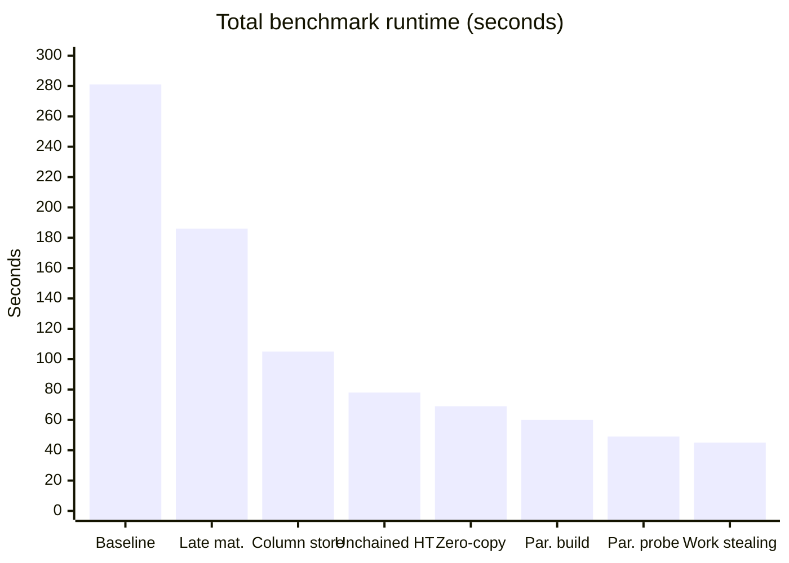

# Optimizing a Join Pipeline: SIGMOD Programming Contest 2025

A C++17 query-execution engine that runs multi-way **hash-join pipelines** over the
IMDB dataset (the [Join Order Benchmark](https://www.vldb.org/pvldb/vol9/p204-leis.pdf)).
We started from the contest's sample solution and optimized it over three phases. We
replaced the hash table, rebuilt the engine around a columnar, late-materialized data
model and then parallelized it.

**Result: total runtime over the benchmark dropped from 281 s to 45 s, a 6.25× speedup
(84% less time).**

> University project for the course *K23a: Software Development for Information Systems*,
> Department of Informatics & Telecommunications, National and Kapodistrian University of Athens.

---

## Table of contents

- [The task](#the-task)
- [Results at a glance](#results-at-a-glance)
- [Phase 1: Open-addressing hash tables](#phase-1-open-addressing-hash-tables)
- [Phase 2: Late materialization, column store and unchained hash table](#phase-2-late-materialization-column-store-and-unchained-hash-table)
- [Phase 3: Zero-copy indexing and parallelism](#phase-3-zero-copy-indexing-and-parallelism)
- [Repository layout](#repository-layout)
- [Building and running](#building-and-running)
- [Testing](#testing)
- [Team](#team)

---

## The task

The contest supplies a query plan that PostgreSQL has already optimized: a tree of
`Scan` and `Join` nodes over pre-filtered input tables. Each table is stored in a paged,
columnar format, with 8 KB pages holding `INT32`, `INT64`, `FP64` or `VARCHAR` values,
null bitmaps and special pages for long strings. The entry point to implement is:

```cpp
ColumnarTable execute(const Plan& plan, void* context);
void* build_context();          // optional: global state such as a thread pool
void  destroy_context(void*);
```

The rules allowed any join algorithm, provided the results matched exactly, and no
third-party libraries in the engine. The sample solution was a straightforward,
row-oriented hash join built on `std::unordered_map`. Our job was to make it as fast as
possible.

---

## Results at a glance

Every time below is the **average of 10 full benchmark runs** (all queries in
`plans.json`), measured with the cached `fast` runner.

| Stage | Runtime | vs. baseline | Speedup |
|---|---:|---:|---:|
| Baseline: sample solution (`std::unordered_map`) | 281.3 s | — | 1.00× |
| **Phase 2:** + Late materialization | 186.1 s | −34% | 1.51× |
| **Phase 2:** + Column-store intermediates | 105.2 s | −63% | 2.67× |
| **Phase 2:** + Unchained hash table | 78.2 s | −72% | 3.60× |
| **Phase 3:** + Zero-copy page sharing | 69 s | −75% | 4.08× |
| **Phase 3:** + Parallel hash-table build | 60 s | −79% | 4.69× |
| **Phase 3:** + Parallel probing | 49 s | −83% | 5.74× |
| **Phase 3:** + Work stealing (final) | **45 s** | **−84%** | **6.25×** |



The optimizations reinforce each other. On its own, the unchained hash table cut runtime
by only ~14% (281 s → 243 s). Combined with late materialization and the column store,
the three Phase 2 changes together cut it by 72%.

---

## Phase 1: Open-addressing hash tables

**Goal:** replace `std::unordered_map`, a node-based chained table that chases pointers on
every probe, with cache-friendly open-addressing designs.

We implemented three hash tables from scratch, each with its own test suite:

| Implementation | Idea | Runtime |
|---|---|---:|
| `std::unordered_map` (baseline) | Separate chaining, one heap node per entry | 281.3 s |
| **Hopscotch** | Each key stays within a fixed neighbourhood of its home bucket, tracked by a bitmap | **260.6 s** |
| **Cuckoo** | Two hash functions; an insert evicts and relocates existing keys | 283.3 s |
| **Robin Hood** | Linear probing that swaps entries to equalize probe distances | 605.9 s* |

\* Robin Hood ran at normal speed on most queries but degraded badly on three
(`8c`: 43 s, `8d`: 41 s, `17a`: 256 s). We traced this to a pathological case we never
fully resolved, so its total is not a fair comparison.

**Takeaway:** Hopscotch gave the best result (~7% faster than the baseline), which matched
what other teams reported. The gain was modest, though, because the engine itself was
still row-oriented and copied values eagerly. Phase 2 tackled that architecture and
replaced these tables with a better design, so the effective baseline going into Phase 2
stayed at **281 s**. The three implementations remain in the repo (`include/robinhood.h`,
`hopscotch.h`, `cuckoo.h`) with their tests.

---

## Phase 2: Late materialization, column store and unchained hash table

### 1. Late materialization (281 s → 186 s)

Copying strings through every join is expensive, so we pass around compact
**references** and resolve them to actual strings only at the end.

- A **`VarcharRef`** packs the location of a string into one 64-bit integer:

  ```
  | 63 ........ 48 | 47 ........ 32 | 31 ........... 12 | 11 ....... 0 |
  |   table_id     |   column_id    |  page_id (~1M)    | value_idx    |
  |   (16 bits)    |   (16 bits)    |    (20 bits)      | (12 bits)    |
  ```

  `NULL` is encoded as the sentinel `0xFFFFFFFFFFFFFFFF`.
- A `value_t` union holds either an `int32_t` or a `VarcharRef`, so every intermediate
  value has the same small fixed size.
- `Scan` was rewritten to process data **column by column** rather than row by row.
- `materialize_varchar` turns references back into strings only when the final output
  is written. This step also handles multi-page long strings (`0xFFFF` / `0xFFFE` page
  markers).

### 2. Column-store intermediates (186 s → 105 s)

The sample solution converted scanned data into a row-based intermediate format and
then back into columns. We removed that round trip, so **no row-store structure exists
anywhere in `execute`**.

- `column_t` is a paged columnar container for intermediate results.
- `ColumnWriter` appends values directly into pages in the contest's page format and
  keeps `VarcharRef`s intact, so late materialization still applies.
- The join reads and writes `column_t` end to end. A `materialize_column` helper unpacks
  a column into a flat vector for fast random access during the join.

### 3. Unchained hash table (105 s → 78 s)

This is an implementation of the **unchained hash table** design (Birler, Schmidt, Fent
& Neumann, *Simple, Efficient, and Robust Hash Tables for Join Processing*, DaMoN 2024).
Instead of per-bucket linked lists, all tuples are stored in one contiguous
**adjacency array**, sorted by hash prefix. Each bucket is therefore a contiguous range
that the probe scans sequentially, with no pointer chasing.

```
 directory (one 64-bit word per bucket)        adjacency array (contiguous)
 ┌──────────────────────────┬──────────┐       ┌─────┬─────┬─────┬─────┬─────┬───
 │ pointer to range (48 bit)│bloom (16)│ ────► │ k,p │ k,p │ k,p │ k,p │ k,p │ …
 └──────────────────────────┴──────────┘       └─────┴─────┴─────┴─────┴─────┴───
                                                 └── bucket b ──┘└ bucket b+1 ┘
```

- **Build:** hash every key, count tuples per bucket, take a prefix sum to get start
  offsets, scatter tuples into place and set each bucket's Bloom bits.
- **Probe:** hash the key, use its prefix to find the directory entry and test the
  **16-bit Bloom filter** (4 bits taken from the hash suffix). If any bit is missing,
  return immediately. Otherwise scan the bucket's range and compare keys for equality.
- **Hashing:** hardware-accelerated **CRC32** (`_mm_crc32_u32`).
- **Sizing:** about **4 tuples per bucket** on average, with the bucket count rounded to a
  power of two.

---

## Phase 3: Zero-copy indexing and parallelism

### 1. Zero-copy page sharing (78 s → 69 s)

For `INT32` input columns that contain **no NULLs**, the page layout already matches
what the engine needs. In that case the scan **shares the input pages instead of copying
them**:

- `column_t` gains a `MappedMemory*` with a reference count. Sharing a page increments
  the count, destroying a column decrements it, and the memory is freed only when the
  count reaches zero.
- `column_has_nulls()` checks each page header (`num_rows != num_non_null`) to decide
  whether this fast path is safe.

That change alone cut runtime by about 11.5%.

### 2. Parallel hash-table build (69 s → 60 s)

Builds with more than **100,000 tuples** run in parallel. Memory comes from a **3-level
slab allocator**, so threads never contend on `malloc`:

| Level | Component | Responsibility |
|---|---|---|
| 1 | `GlobalAllocator` | Hands out large **64 KB** chunks, one at a time per thread |
| 2 | `BumpAllocThread` | Owns its 64 KB chunks and bump-allocates **8 KB** slabs to partitions |
| 3 | `BumpAllocPartition` | Bump-allocates individual `AdjacencyEntry` tuples within an 8 KB slab |

The build runs in two passes:

1. **Collect:** threads hash their slice of the input and append tuples to
   thread-local partitions.
2. **Merge:** for each partition, gather tuples from all threads, count per bucket, take
   a prefix sum, copy into the final adjacency array and set the Bloom filters.

**Tuning choices** (all chosen by measurement):

- **4 fixed partitions.** This beat `partitions = threads` by about 0.5 s because there
  is less merging overhead.
- **100k-tuple threshold.** Smaller builds don't recover the threading overhead.
  Higher thresholds were slightly worse.
- **At most 8 threads** (`min(hardware_concurrency, 8)`).

### 3. Parallel probing (60 s → 49 s)

The assignment did not specify a design for this step, so we built a lock-free one.
Probe sides with more than **5,000 rows** are split across threads:

- Each thread owns its own result columns and `ColumnWriter`s and writes into **its own
  pages**, so no locks are needed.
- When all threads finish, a single thread merges the results by **moving page
  pointers** into the final columns. No values are copied.

### 4. Work stealing (49 s → 45 s)

Static partitioning left fast threads idle while slower ones were still working. Probe
rows are now handed out dynamically through a shared `std::atomic<size_t>` counter,
in chunks of **`WORK_CHUNK_SIZE = 1000`** rows (`fetch_add`). Threads that finish early
take more chunks, which balances the load automatically without locks.

We tested chunk sizes of 500, 1000, 2000, 2500, 4000 and 5000. **1000** and **2500**
performed best and almost identically. These sizes appear to balance atomic-operation
overhead against load-balancing granularity. Oddly, 2000 performed worse than both.

---

## Repository layout

```
├── src/
│   ├── execute.cpp            # Final engine: scan, join (parallel build/probe), materialization
│   ├── build_table.cpp        # Contest-provided: table construction
│   ├── csv_parser.cpp         # Contest-provided: CSV loading
│   └── statement.cpp          # Contest-provided: SQL statement handling
├── include/
│   ├── project2.h             # Phase 2: VarcharRef, value_t, column_t, ColumnWriter, CRC32, Bloom
│   ├── parallelProject.h      # Phase 3: slab allocator, parallel UnchainedHashTable, ExecutionContext
│   ├── robinhood.h            # Phase 1: Robin Hood hash table (kept for reference)
│   ├── hopscotch.h            # Phase 1: Hopscotch hash table (kept for reference)
│   ├── cuckoo.h               # Phase 1: Cuckoo hash table (kept for reference)
│   └── plan.h, table.h, ...   # Contest-provided data structures
├── tests/                     # Catch2 unit tests + contest test harness (read_sql.cpp)
├── job/                       # Join Order Benchmark SQL queries and schema
├── plans.json                 # Pre-optimized query plans used for evaluation
├── download_imdb.sh           # Fetches the IMDB dataset
└── .github/workflows/         # CI: builds and runs unit_tests on every push / PR
```

---

## Building and running

**Requirements:** CMake ≥ 3.16, a C++17 compiler (developed with **Clang 18**) and an
**x86-64 CPU with SSE4.2**, which the CRC32 hash needs. The build uses `-march=native`.
Dependencies for the test harness (DuckDB, Catch2 and others) are fetched automatically
by CMake.

```bash
# 1. Download the IMDB dataset
./download_imdb.sh

# 2. Build
cmake -S . -B build -DCMAKE_BUILD_TYPE=Release -Wno-dev
cmake --build build -- -j $(nproc)

# 3. Build the DuckDB reference database (used to verify correctness)
./build/build_database imdb.db

# 4. Run every query and check the results
./build/run plans.json
```

### Faster iteration with the cache (Linux/macOS)

`build_cache` stores the input tables and the expected results of every query, and
loads them with `mmap`. The `fast` runner then skips DuckDB entirely. It is much quicker
to compile and run, and all timings above were measured with it.

```bash
./build/build_cache plans.json                 # one-time
cmake --build build -- -j $(nproc) fast        # rebuild only the fast runner
./build/fast plans.json
```

---

## Testing

Each phase has a Catch2 test suite. CI (GitHub Actions) builds and runs `unit_tests`
on every push and pull request to `main`.

```bash
cmake --build build --target <suite> -j && ./build/<suite>
```

| Suite | Covers |
|---|---|
| `unit_tests` | End-to-end join correctness: empty inputs, NULL keys, duplicate keys, build side, multi-way and left-deep joins |
| `robinhood_tests`, `hopscotch_tests`, `cuckoo_tests` | Phase 1 hash tables |
| `part1_tests` | Late materialization: `VarcharRef` encoding, `value_t`, bitmaps, long-string pages |
| `part2_tests` | Column store: `column_t` lifetime/move semantics, `ColumnWriter`, materialization round-trips |
| `part3_tests` | Unchained hash table: insert/probe, edge cases, randomized checks |
| `parallelProject_tests` | Phase 3: each slab-allocator level, `column_has_nulls`, parallel build, memory stress |

---

## Team

| Member | Main contributions |
|---|---|
| **Vasileios Zaritas** | Cuckoo hashing and Hopscotch (with Georgia-Maria) · late materialization · column store (with Georgia-Maria) · performance measurement and tuning at every stage · documentation |
| **Georgia-Maria Valvi** | Robin Hood hashing and Hopscotch (with Vasileios) · unchained hash table · column store (with Vasileios) · unit tests · GitHub Actions CI · multi-executable build setup |

Phase 3 (zero-copy indexing, parallel build, parallel probing and work stealing) was
completed jointly.

---

*The project skeleton, data format, test harness and benchmark come from the
**SIGMOD Programming Contest 2025**. The JOB queries come from Leis et al.,
"How Good Are Query Optimizers, Really?", PVLDB 9(3), 2015.*
